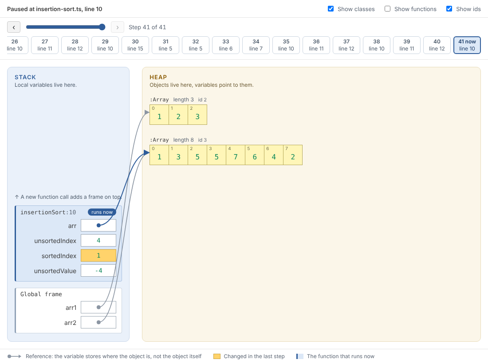
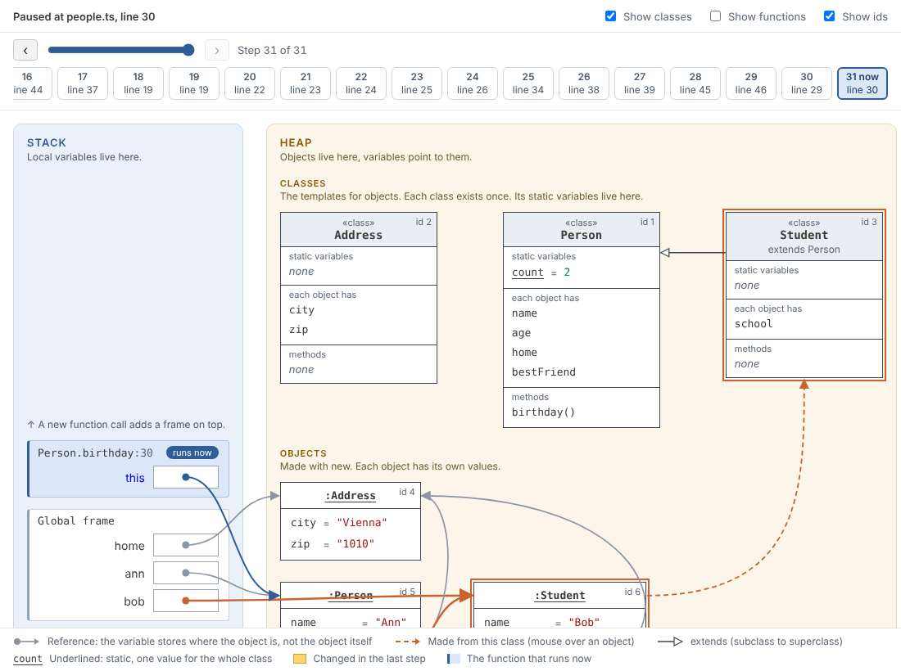
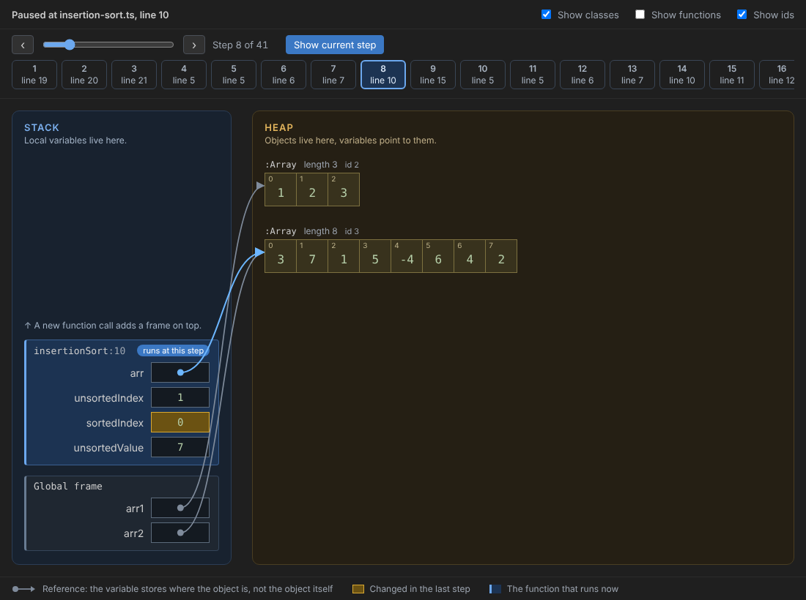

# Heap Stack

Heap Stack is a Visual Studio Code extension for teaching. It shows the memory of a TypeScript program
while you debug it: the **stack** with one frame for each function call, and the **heap** with the
objects and arrays that the variables point to. It works like [Python Tutor](https://pythontutor.com),
but inside VS Code, with the normal debugger, and with [Deno](https://deno.com) as the runtime.



## What the Heap Stack view shows

- **STACK** (blue area): one frame for each function call. The stack builds bottom up: the Global
  frame is at the bottom, and each function call adds a frame on top. The function that runs now is
  the top frame and has the label "runs now". Each variable is a box. A number, a string or a boolean
  is written in the box.
- **HEAP** (yellow area): objects and arrays. A variable that holds an object stores only *where*
  the object is. The view draws this as an arrow from the variable to the object. Two arrows to the
  same object mean that two variables point to the same object.
- **Objects** use UML object notation: `:Person` (underlined) in the head, and one line
  `name = value` for each attribute.
- **Arrays** are a row of cells, with the index at the top left of each cell.
- **Classes** are at the top of the heap, because in JavaScript a class is also an object on the
  heap. A class box shows the **static variables** (class variables) with their values, underlined
  as in UML, the attributes that each object gets, and the methods. A subclass shows
  "extends" and the UML arrow to its superclass. Move the mouse over an object to see a dashed arrow
  to the class it was made from.
- **Changes**: everything that changed in the last step has a yellow background.



### Step history

Each time the program pauses (a breakpoint or a step), the view saves a step. Use the step list,
the slider or the Left and Right arrow keys to go back to an earlier step. The view then shows the
memory as it was at that step. The editor shows the line where the program was at that step, also
when that line is in another file. It marks the line as the debugger marks a stack frame that you
select: a green arrow and a green line. The yellow line of the debugger stays the current position
of the program. The line is in your TypeScript file, because VS Code's debugger reads Deno's source
map. Select
**Show current step** (or press End) to go back to the newest step.



The view follows the color theme of VS Code: light, dark and high contrast.

## Requirements

- VS Code 1.90 or newer. The extension uses the JavaScript debugger that is built into VS Code.
- [Deno 2](https://docs.deno.com/runtime/getting_started/installation/) on the `PATH`, or the
  setting `heapStack.denoPath` pointing to the Deno program.

## How to use it

1. Open a TypeScript file.
2. Run the command **Run with Heap Stack** (Command Palette, or the button at the top right of the
   editor).
3. The program pauses at its first line, and the **Heap Stack** view opens next to the code.
4. Use **Step Over** (F10) and **Step Into** (F11) of the debugger. The view changes at each step.

You can also use your own launch configuration (`.vscode/launch.json`). In `launch.json`, select
**Add Configuration…** and then **Heap Stack: Debug a TypeScript file with Deno**. The view opens at
the first pause of any JavaScript or TypeScript debug session. The folder [examples](examples) has
three small programs and a `launch.json`.

## Settings

| Setting | Default | What it does |
| --- | --- | --- |
| `heapStack.denoPath` | `deno` | Path to the Deno program. |
| `heapStack.inspectPort` | `9229` | Port on which Deno waits for the debugger. |
| `heapStack.stopOnEntry` | `true` | Pause at the first line of the program. |
| `heapStack.openAutomatically` | `true` | Open the Heap Stack view at the first pause of a debug session. |
| `heapStack.maxHistorySteps` | `500` | Number of steps that the view keeps for the step history. |
| `heapStack.maxObjects` | `300` | Number of heap objects that are read per stack frame. |
| `heapStack.maxArrayItems` | `100` | Number of array items, set members and map entries per object. |
| `heapStack.maxStringLength` | `200` | Number of characters per string. |

The toolbar of the view has three switches: **Show classes**, **Show functions** (functions, and the
variables that hold functions or classes) and **Show ids** (the object ids).

## How it works

The Debug Adapter Protocol does not tell whether two variables point to the same object. So, at each
pause, the extension runs a small helper inside the paused program (through the debugger's
`evaluate` request). The helper gives each object an id that stays the same from step to step, and
describes the objects that the variables can reach. It does not call getters, so reading the memory
does not change the program. The code is in [src/heapWalker.ts](src/heapWalker.ts) and
[src/snapshot.ts](src/snapshot.ts).

Limits:

- Private fields (`#name`) are not shown, because JavaScript does not allow other code to read them.
- Getters are shown as `get`, not with their value.
- Only frames up to the first `await` are shown. Earlier frames of an `async` function are not on
  the stack any more.

## Development

The npm scripts are the same as in the other nimblescape extensions. Node is the version in
[.node-version](.node-version).

```sh
npm install
npm run build          # builds dist/ (npm run watch: builds again after each change)
npm run typecheck
npm test               # unit tests (vitest)
npm run test:deno      # tests against a real Deno program (needs Deno, or DENO_PATH)
npm run test:render    # screenshots of the view in three themes (test/render/output)
npm run test:vscode    # tests in a real VS Code (downloads VS Code; use xvfb-run on Linux)
npm run package        # builds heap-stack-<version>.vsix (minified, without source maps)
npm run install-local  # builds the .vsix and installs it into the VS Code of this computer
```

`npm run record` records the example programs step by step with Deno into
`test/render/snapshots`, which the screenshot test uses.

## License

[MIT](LICENSE)
