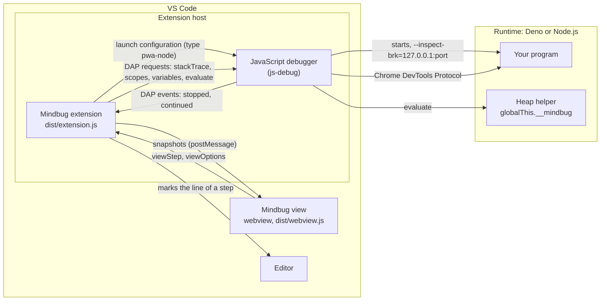

# Architecture

This document describes how Mindbug works inside: its components, the main flows, the data that it reads and draws, where it keeps that data, how it names things, and how it is tested. The user guide is [guide.md](guide.md); the security model is in [security.md](security.md).

## Overview

Mindbug has no debug adapter of its own. VS Code's JavaScript debugger (`ms-vscode.js-debug`) starts and controls the program; Mindbug only listens to the messages of that debugger and sends it its own requests.

The rule that holds everything together: **at each pause, the extension builds one snapshot of the memory, and the view only draws snapshots.** The snapshot is plain data (`src/model.ts`): the frames with their variables, and the heap objects by id. The view keeps the snapshots of the session as the step history, so it can draw any earlier step without a question to the program.

The Debug Adapter Protocol (DAP) has no stable object id: two variables that point to one array look like two arrays. So the extension runs a small helper inside the paused program, with the DAP request `evaluate`. The helper gives each object a number that stays the same from step to step, and returns the variables and the objects that they reach as JSON text.

## Components

### The extension

The extension runs in the extension host of VS Code (`extensionKind: workspace`), in the bundle `dist/extension.js`.

| Module | What it does |
| --- | --- |
| `src/extension.ts` | Activates the extension: creates the controller, registers the configuration provider of the debug type `mindbug`, and the commands **Run with Mindbug** and **Open Mindbug**. Returns the small API that the tests in VS Code use. |
| `src/launch.ts` | The debug type `mindbug` and the command **Run with Mindbug**. `MindbugConfigurationProvider` turns a configuration of type `mindbug` into one of the JavaScript debugger. |
| `src/runtime.ts` | Chooses the runtime (`auto`, `deno`, `node`) with `deno --version` and `node --version`, and builds the configuration of the JavaScript debugger for it. It does not import `vscode` at run time, so unit tests run it. |
| `src/controller.ts` | Follows the debug sessions of the JavaScript debugger, reads a snapshot at each pause, keeps the step history of the newest session for a view that opens later, and marks the line of an earlier step in the editor. |
| `src/snapshot.ts` | Builds one snapshot with the DAP requests `stackTrace`, `scopes`, `variables` and `evaluate`. It does not import `vscode`, so tests run it with a fake debug session. |
| `src/heapWalker.ts` | The heap helper, whose text runs in the program, and the expressions that install and call it. |
| `src/changes.ts` | Finds what changed between two snapshots, for the yellow background of the view. The view bundle uses it. |
| `src/model.ts` | The types of a snapshot and of the messages between the extension and the view. |
| `src/panel.ts`, `src/webviewHtml.ts` | The webview panel "Mindbug" beside the editor, and its HTML page with its content security policy. |

### The heap helper

`installHeapWalker` in `src/heapWalker.ts` is one function whose text (`Function.prototype.toString`) the extension sends to the program with `evaluate`. It defines the global property `__mindbug` (not enumerable) with the functions `begin`, `v`, `err`, `end`, `size` and `chunk`. A second install with the same `WALKER_VERSION` does nothing.

- At its install, the helper keeps references to the built-in functions that it uses (`Object.getPrototypeOf`, `Reflect.ownKeys`, `Map.prototype.entries`, …), so that a program that changes these built-ins later does not change what the helper reads.
- It gives each object a number in a `WeakMap`, so the numbers do not keep any object alive, and an object keeps its number while it lives.
- It reads property descriptors and never calls a getter, a setter, `toString`, `valueOf` or `toJSON` of the program. A `Proxy` is the one exception: reading it runs the traps of its handler.
- For each frame, the extension sends one expression (`frameExpression`) that calls `__mindbug.v(name, value)` for each variable, each in its own `try`/`catch`, so that a `let` before its declaration does not stop the others. `__mindbug.end()` walks the objects that the variables reach, breadth first, up to the limits of the settings, and returns the JSON text.
- The JavaScript debugger can shorten a long result text. Then the extension asks for the size (`__mindbug.size()`) and reads the text in parts of 150 characters (`__mindbug.chunk(i, 150)`).

The text of `installHeapWalker` must run in another program, so the function uses only its parameters and the globals of JavaScript, and the build must not add helper calls to it: `esbuild.mjs` therefore does not set the option `keepNames`.

### The view

The view is a webview with the bundle `dist/webview.js` and the style sheet `dist/webview.css`. Its content security policy allows only the scripts with the nonce of the page, and the styles and images of the extension; it loads nothing from the network.

| Module | What it does |
| --- | --- |
| `webview/main.ts` | Receives the messages of the extension, keeps the step history, draws the selected step, and handles the toolbar, the step list and the keys. |
| `webview/history.ts` | The step history of one session, without DOM code, so that unit tests use it. |
| `webview/layout.ts` | Places the variables and the heap objects bottom up (see [Layout](#layout)). |
| `webview/render.ts` | Builds the HTML of the scopes, the variables, the UML boxes, the arrays, the maps and the sets. |
| `webview/arrows.ts` | Draws the arrows as one SVG layer above the stack and the heap. |
| `webview/style.css` | The styles. All colors are tokens (`--mb-*`) for the light, dark and high contrast themes. |

## The main flows

### Start

1. **Run with Mindbug** saves the file and calls `vscode.debug.startDebugging` with a configuration of type `mindbug`. F5 and `launch.json` give the same configuration.
2. `MindbugConfigurationProvider.resolveDebugConfiguration` checks `request` and `runtime`, reads the settings, and chooses the runtime with `chooseRuntime`. When no runtime runs, it shows a message and returns `undefined`, which stops the launch.
3. It returns a configuration of type `pwa-node`: the runtime as `runtimeExecutable`, the options `--inspect-brk=127.0.0.1:<port>` (Deno also `run` and `--allow-all`, Node.js also `--experimental-transform-types`), and `attachSimplePort: <port>`. The type is `pwa-node`, not `node`: with `node` and `attachSimplePort`, the debugger continues at the pause of `--inspect-brk`, and the program does not stop at its first line.
4. Because the type changed, VS Code resolves the configuration again with the provider of the JavaScript debugger, replaces the variables such as `${file}`, and the debugger starts the runtime and connects to the port.

A launch configuration of type `node` or the JavaScript Debug Terminal starts the program without Mindbug; the flows below are the same.

### Pause

1. The controller registers a debug adapter tracker for the types `pwa-node`, `node` and `node-terminal` (`JS_DEBUG_TYPES`). The tracker sees the DAP event `stopped`.
2. At the first pause of a session, the controller opens the view (setting `nimblescape.mindbug.openAutomatically`).
3. 40 ms after the newest pause, the controller calls `collectSnapshot`. A newer pause or a step in the meantime makes the older read worthless, so a sequence number drops its result.
4. `collectSnapshot` reads the stack trace and keeps the frames of files on disk, up to the first frame of an async boundary (`presentationHint: label`) and at most 30 frames. The frames of the runtime's own code have a `sourceReference` and no path on disk, so they are left out.
5. It installs the helper in the top frame, and for each frame reads the scopes and the names of the variables (`scopes`, `variables`), then the values and the objects through the helper (`evaluate`). The module function of a CommonJS file of Node.js becomes the Global scope, as the Module scope of Deno.
6. When the helper cannot run, the snapshot uses the values of the DAP request `variables` as text, without ids, and is marked as `fallback`.
7. The controller adds the snapshot to its history and posts it to the view, which computes the changes against the step before it and draws the step.

A DAP request `continue`, `next`, `stepIn` or `stepOut`, or the event `continued`, marks the program as running; after 300 ms without a new pause, the view says "The program is running…". The end of the session marks it as ended.

### Step history

1. The step list, the slider or a key selects an earlier step. The view draws the snapshot of that step and sends `viewStep` with its file and line.
2. The controller opens that file when it is not visible, shows the line, and marks it with a green arrow and a green line, as the debugger marks a selected stack frame, and with the text "Mindbug: step 8 of 14" at its end (`stepMarkText` in `src/model.ts`). The yellow line of the debugger stays the current position.
3. **Show current step** (or End) selects the newest step again, and the controller removes the mark.

A view that opens later receives the whole history of the newest session (message `history`). A new session starts a new history.

## The snapshot

A snapshot (`MemorySnapshot` in `src/model.ts`) holds:

- `frames`: the scopes, the oldest (the Global scope) first. Each frame has its name, file, line and variables. A variable has a name, a value and the kind of its scope (local, block, closure, module, global).
- `objects`: the heap objects by their number: arrays, objects, maps, sets, functions and classes, each with its class (`cls`), its fields or items, and for a class its static variables, attributes, methods and superclass.
- `missing`: the numbers of objects that the limits left out; the view draws them as "… not loaded".

A value (`Value`) is a number, a string (perhaps cut at `maxStringLength`), a boolean, `undefined`, `null`, a BigInt, a symbol, a reference to an object (`ref`), an uninitialized binding, a hole of a sparse array, a getter or setter (never called), or a value that could not be read.

## Layout

The view draws the stack and the heap bottom up, as a stack of memory grows:

- **Scopes**: the Global scope at the bottom, the newest function call on top. A sticky pile keeps the bottom of the stack in view.
- **Variables of a scope**: the first variable at the bottom (`varsBottomUp` in `webview/layout.ts`); the closure variables are below the own variables.
- **Heap rows**: each object that a variable points to starts a row, and the objects that it points to are placed to its right (`layoutHeap`). An object is placed only once, in the row of the oldest scope and the oldest variable that point to it; later references are arrows. The rows follow the order of the variables, so the objects of the Global scope are at the bottom, next to the Global scope.
- **Classes**: in their own part at the top of the heap, a superclass before its subclasses.

## Where the data lives

| Data | Where | How long |
| --- | --- | --- |
| The step history | The memory of the extension host (controller) and of the webview | Until the next debug session starts, or VS Code closes |
| The switches of the toolbar | The settings `nimblescape.mindbug.showClasses`, `showFunctions` and `showIds`: the page of the view gets them in the attribute `data-view-options`, a click on a switch sends `viewOptions`, and the controller saves it in the user settings with `WorkspaceConfiguration.update`. A click on a switch that the settings of the workspace set stays in the memory of the controller (`viewOverrides`) until the view closes | Until you change them |
| The numbers of the objects | A `WeakMap` of the helper in the program | While the program runs |
| The global `__mindbug` | The program | While the program runs |

Mindbug writes no file, uses neither `globalState` nor `workspaceState` of VS Code, and stores no secret. It does not use `globalState` for the switches on purpose: VS Code keeps the state of an extension after its uninstall, and the settings are visible and stay under your control.

## Naming

| What | Name |
| --- | --- |
| Extension ID | `nimblescape.nimblescape-mindbug` (see [Naming](../CONTRIBUTING.md#naming)) |
| Debug type | `mindbug` |
| Commands | `nimblescape.mindbug.run` (**Run with Mindbug**), `nimblescape.mindbug.open` (**Open Mindbug**) |
| Settings | `nimblescape.mindbug.*` |
| Webview panel | `nimblescape.mindbug.memory` |
| Global of the helper | `__mindbug` |

The view says "scope", not "frame", because students know the word from the lessons; the code uses "frame" for the DAP stack frame.

## Code layout and build

| Folder | Content |
| --- | --- |
| `src/` | The extension. |
| `webview/` | The view. |
| `test/unit/` | Unit tests with vitest, without Deno and without VS Code. |
| `test/deno/` | Tests against real Deno programs through the V8 inspector, with a fake debug session. |
| `test/render/` | The recorded steps of the examples and the screenshot test. |
| `test/vscode/` | Tests in a real VS Code with mocha. |
| `test/gif/` | The recorder of the animation of the README: a real VS Code with the package steps through `examples/return-object.ts` (`npm run gif`). |
| `examples/` | The example programs, which the tests in VS Code, the screenshot test and the animation of the README also use. |
| `scripts/` | The local install and uninstall, the build of the VS Code tests, and the shared release scripts. |
| `media/`, `resources/` | The icons of the commands and the editor, and the icon of the Marketplace. |

`esbuild.mjs` builds two bundles: `dist/extension.js` (Node.js 24, CommonJS, without the module `vscode`) and `dist/webview.js` (browser, IIFE), and copies `webview/style.css` to `dist/webview.css`. Both bundles are readable, not minified. TypeScript checks the types (`npm run typecheck`); esbuild does not.

## Testing

| Command | What it tests |
| --- | --- |
| `npm test` | The unit tests of `test/unit/`: the layout, the arrows, the changes, the step history, the choice of the runtime, the snapshot with a fake debug session, and the helper in Node.js (the same V8 engine as Deno). Also the test of the release checks (`scripts/release-checks.test.mjs`) and of the manifest and the documents. |
| `npm run test:deno` | The snapshot of real Deno programs (`test/deno/fixtures/`) through the V8 inspector: aliasing, stable ids, getters that are not called, closures, uninitialized `let`, classes. Needs Deno. |
| `npm run test:render` | Loads the real page of the view in Chromium, sends it the recorded steps of `test/render/snapshots/`, and saves screenshots in the light, dark and high contrast themes. It checks that the page has no script error, that every arrow has a target, and that the step history works. `npm run record` records the steps again with Deno after a change of the examples or of the snapshot. |
| `npm run test:vscode` | Starts a real VS Code (`@vscode/test-cli`) with the extension and the folder `examples/`, and debugs the examples four ways: **Run with Mindbug** with Deno and with Node.js, a launch configuration of type `mindbug`, and one of type `node`. It checks the first pause, the scopes and their variables, aliasing, the classes, the call stack example, the runtime that Mindbug starts, and the line of an earlier step in the editor. `VSCODE_TEST_VERSION` selects the VS Code version. |

CI runs all of them for every push to `main` and every pull request; the workflow "VS Code versions" runs the tests in VS Code once per week on VS Code Insiders and on the lowest supported version (see [CONTRIBUTING.md](../CONTRIBUTING.md)).

© 2026 Hannes Stauss (scalarion@nimblescape.com) · [MIT License](../LICENSE).
