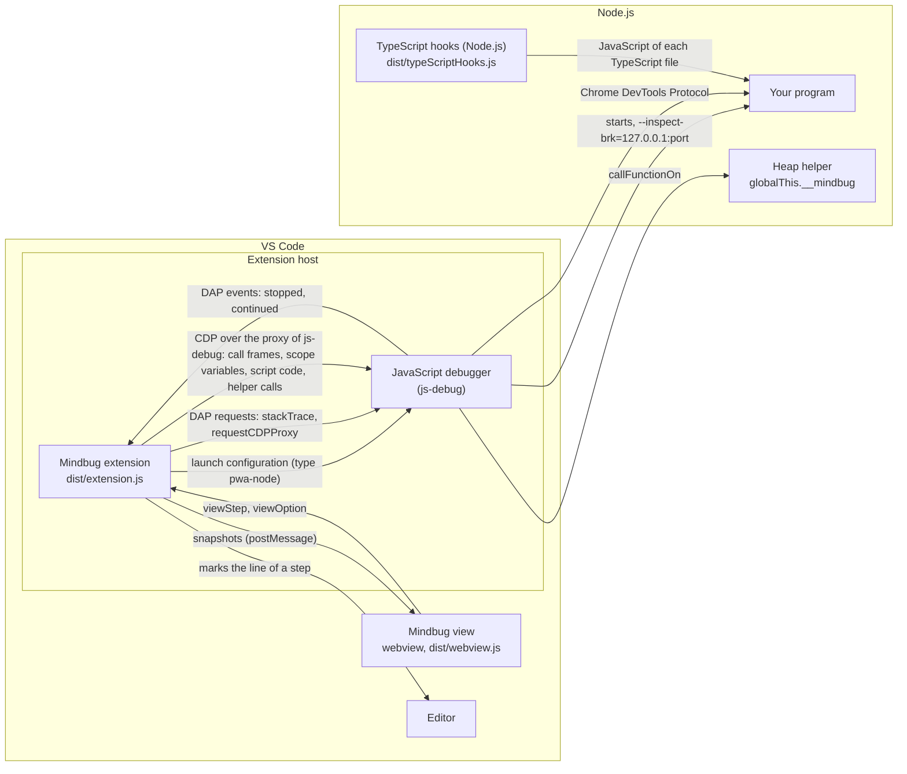

# Architecture

This document describes how Mindbug works inside: its components, the main flows, the data that it reads and draws, where it keeps that data, how it names things, and how it is tested. The user guide is [guide.md](guide.md); the security model is in [security.md](security.md).

## Overview

Mindbug has no debug adapter of its own. VS Code's JavaScript debugger (`ms-vscode.js-debug`) starts and controls the program; Mindbug only listens to the messages of that debugger, asks it for the stack trace, and reads the memory from V8, the JavaScript engine of Node.js, through the connection to V8 that the debugger gives to other extensions.

The rule that holds everything together: **at each pause, the extension builds one snapshot of the memory, and the view only draws snapshots.** The snapshot is plain data (`src/model.ts`): the frames with their variables, and the heap objects by id. The view keeps the snapshots of the session as the step history, so it can draw any earlier step without a question to the program.

The extension uses two protocols:

- The **Debug Adapter Protocol (DAP)**, between VS Code and its debuggers, for one request per step: `stackTrace`, the frames of the stack with their names, files and lines. The JavaScript debugger reads the source maps, so the lines are the lines of the TypeScript file.
- The **Chrome DevTools Protocol (CDP)** of V8 for everything else: the call frames of the pause, the variables of their scopes, and the heap. The DAP request `requestCDPProxy` of the JavaScript debugger gives the address of a WebSocket server of the debugger, which sends each CDP request on to V8 (`src/v8Connection.ts`). V8 gives the variables of a scope in the order of the program, while the debugger sorts them by name in its DAP answers.

Neither protocol has a stable object id: two variables that point to one array look like two arrays. So the extension runs a small helper inside the paused program, with the CDP request `Runtime.callFunctionOn`, and gives it the values of the variables that V8 lists in the scopes. The helper gives each object a number that stays the same from step to step, and returns the values and the objects that they reach as JSON text.

## Components

### The extension

The extension runs in the extension host of VS Code (`extensionKind: workspace`), in the bundle `dist/extension.js`.

| Module | What it does |
| --- | --- |
| `src/extension.ts` | Activates the extension: creates the controller, registers the configuration provider of the debug type `mindbug`, and the commands **Run with Mindbug** and **Open Mindbug**. Returns the small API that the tests in VS Code use. |
| `src/launch.ts` | The debug type `mindbug` and the command **Run with Mindbug**. `MindbugConfigurationProvider` turns a configuration of type `mindbug` into one of the JavaScript debugger. |
| `src/runtime.ts` | Checks Node.js with `node --version` (`findNode`), finds the TypeScript compiler that VS Code uses (`typeScriptCompiler`), gives the options with which Node.js runs TypeScript (`nodeTypeScript`), and builds the configuration of the JavaScript debugger. It does not import `vscode` at run time, so unit tests run it. |
| `src/typeScriptHooks.ts` | The hooks with which Node.js runs TypeScript, in their own bundle `dist/typeScriptHooks.js`. They run in the program, not in the extension host: a hook of the module loader of Node.js turns each TypeScript file into JavaScript with the compiler of the environment variable `NIMBLESCAPE_MINDBUG_TYPESCRIPT` and the options of its `tsconfig.json` (see [TypeScript in Node.js](#typescript-in-nodejs)). They import only modules of Node.js. |
| `src/controller.ts` | Follows the debug sessions of the JavaScript debugger, reads a snapshot at each pause, keeps the step history of the newest session for a view that opens later, and marks the line of an earlier step in the editor. |
| `src/snapshot.ts` | Builds one snapshot with the DAP request `stackTrace` and the CDP requests `Runtime.getProperties`, `Debugger.getScriptSource` and `Runtime.callFunctionOn`. It does not import `vscode`, so tests run it with a fake debug session. |
| `src/blockKind.ts` | Names a block scope after its statement (`if`, `for`, `while`, …), from the code where V8 says that the scope starts. It does not import `vscode`. |
| `src/blockRanges.ts` | Finds the block scopes of the paused frame in the TypeScript file, for their marks in the editor. It does not import `vscode`. |
| `src/v8Connection.ts` | The connection to V8 through the CDP proxy of the JavaScript debugger: a WebSocket client, and the call frames of the current pause. It does not import `vscode`. |
| `src/heapWalker.ts` | The heap helper, whose text runs in the program, and the functions that install and call it. |
| `src/changes.ts` | Finds what changed between two snapshots, for the yellow background of the view. The view bundle uses it. |
| `src/model.ts` | The types of a snapshot and of the messages between the extension and the view. |
| `src/panel.ts`, `src/webviewHtml.ts` | The webview panel "Mindbug" beside the editor, and its HTML page with its content security policy. |

### The heap helper

`installHeapWalker` in `src/heapWalker.ts` is one function whose text (`Function.prototype.toString`) the extension sends to the program with `Runtime.callFunctionOn`. It defines the global property `__mindbug` (not enumerable) with the functions `begin`, `v` and `end`. A second install with the same `WALKER_VERSION` does nothing. The helper stays in the program until the program ends, so the extension installs it only at the first step of a debug session, and again when the walker function returns `NOT_INSTALLED` (a new program in the same session).

- At its install, the helper keeps references to the built-in functions that it uses (`Object.getPrototypeOf`, `Reflect.ownKeys`, `Map.prototype.entries`, …), so that a program that changes these built-ins later does not change what the helper reads.
- It gives each object a number in a `WeakMap`, so the numbers do not keep any object alive, and an object keeps its number while it lives.
- It reads property descriptors and never calls a getter, a setter, `toString`, `valueOf` or `toJSON` of the program. A `Proxy` is the one exception: reading it runs the traps of its handler.
- For each frame, the extension calls one function (`walkerFunction`) with `Runtime.callFunctionOn`. Its arguments are the limits and the values that V8 lists in the scopes of the frame: an object by its id of V8 (`objectId`), any other value by its value (`callArgument` in `src/snapshot.ts`). The function calls `__mindbug.v(index, value)` for each value, and `__mindbug.end()` walks the objects that the values reach, breadth first, up to the limits of the settings, and returns the JSON text. The snapshot finds the variable of each value by its index. When `__mindbug` is missing or has another version, the function returns `NOT_INSTALLED` and reads no value.
- The function runs on the global object of the frame (the `global` scope of its scope chain), not in the scope of the frame, so it reads no variable by its name. This way it also reads a variable that a variable of the same name in an inner block hides, and a `let`, `const` or `class` before its line causes no `ReferenceError`: V8 lists such a variable without a value, the snapshot shows it as uninitialized, and the helper does not get it. (An exported one before its line is no special case either: with an evaluation of its name, V8 gave an internal empty value, and `typeof` on that value stopped Deno and Node.js.)
- V8 runs the function `silent` (an exception in it does not pause the program) and `returnByValue` (V8 gives the whole string, of any length).

The text of `installHeapWalker` must run in another program, so the function uses only its parameters and the globals of JavaScript, and the build must not add helper calls to it: `esbuild.mjs` therefore does not set the option `keepNames`.

### The view

The view is a webview with the bundle `dist/webview.js` and the style sheet `dist/webview.css`. Its content security policy allows only the scripts with the nonce of the page, and the styles and images of the extension; it loads nothing from the network.

| Module | What it does |
| --- | --- |
| `webview/main.ts` | Receives the messages of the extension, keeps the step history, draws the selected step, and handles the toolbar, the step list and the keys. |
| `webview/history.ts` | The step history of one session, without DOM code, so that unit tests use it. |
| `webview/layout.ts` | Places the variables and the heap objects bottom up (see [Layout](#layout)). |
| `webview/render.ts` | Builds the HTML of the scopes, the variables, the UML boxes, the arrays, the maps and the sets. |
| `webview/arrows.ts` | Draws the arrows as one SVG layer above the stack and the heap. |
| `webview/style.css` | The styles. All colors are tokens (`--mb-*`) for the light, dark and high contrast themes. |

## The main flows

### Start

1. **Run with Mindbug** saves the file and calls `vscode.debug.startDebugging` with a configuration of type `mindbug`. F5 and `launch.json` give the same configuration.
2. `MindbugConfigurationProvider.resolveDebugConfiguration` checks `request`, stops a configuration with `"runtime": "deno"` of Mindbug 0.1 with a message, reads the settings, and checks Node.js with `findNode`. It finds the TypeScript compiler with `typeScriptCompiler`: the settings `js/ts.tsdk.path` and `typescript.tsdk` of the workspace folder, else the TypeScript of VS Code (`vscode.env.appRoot`). `stopOnEntry` comes from the switch **Stop on entry** of the view (`MemoryController.stopOnEntry`: the setting, or a click that the settings of the workspace overrule in this window), unless the configuration has the attribute `stopOnEntry`; when it is off, the option is `--inspect-wait` instead of `--inspect-brk`. When Node.js does not run, it shows a message and returns `undefined`, which stops the launch.
3. It returns a configuration of type `pwa-node`: Node.js as `runtimeExecutable`, the options `--inspect-brk=127.0.0.1:<port>` (Node.js 22.18 and newer also `--require` with `dist/typeScriptHooks.js`, and the environment variable `NIMBLESCAPE_MINDBUG_TYPESCRIPT` with the compiler in `env`; Node.js 22.7 to 22.17 `--experimental-transform-types`), and `attachSimplePort: <port>`. The type is `pwa-node`, not `node`: with `node` and `attachSimplePort`, the debugger continues at the pause of `--inspect-brk`, and the program does not stop at its first line. `skipFiles` (`SKIP_FILES`) names the code of Node.js (`<node_internals>/**`), so that a step does not stop in it.
4. Because the type changed, VS Code resolves the configuration again with the provider of the JavaScript debugger, replaces the variables such as `${file}`, and the debugger starts Node.js and connects to the port.

A launch configuration of type `node` or the JavaScript Debug Terminal starts the program without Mindbug; the flows below are the same.

### TypeScript in Node.js

Node.js only strips the types of a TypeScript file, and Node.js 26 removed the option `--experimental-transform-types`, which also ran enums and constructor parameter properties. So Mindbug has its own hooks of the module loader, `src/typeScriptHooks.ts`, in the bundle `dist/typeScriptHooks.js`, which Node.js loads with `--require` before the program. They need synchronous module hooks (`module.registerHooks`) and the type stripping of Node.js without an option: Node.js 22.18, 23.6, 24 and later (`nodeRunsHooks`). The hooks load the compiler of the variable `NIMBLESCAPE_MINDBUG_TYPESCRIPT` (a file `typescript.js` of TypeScript 5 or 6), remove the variable, and register a `load` hook. For each TypeScript file (`.ts`, `.mts`, `.cts`, not `.d.ts`), the hook:

1. Decides the module format as Node.js does (`moduleFormat`): a `.mts` file is an ES module, a `.cts` file a CommonJS module, and a `.ts` file has the `type` of its `package.json`. Without a `type`, a file with `import` or `export` is an ES module (`ts.isExternalModule`), any other file a CommonJS module.
2. Lets Node.js read the file, with the format `module-typescript` or `commonjs-typescript`. With a format, Node.js does not look at the code; without it, Node.js would strip the types of a `.ts` file without `type` to look for `import` and `export`, and stop at an enum.
3. Compiles the text with `ts.transpileModule` and the options of the `tsconfig.json` of the file (`ts.findConfigFile`, `ts.parseJsonConfigFileContent`), with the changes of `compilerOptions`: the module kind of the format, output on (`noEmit` off), no declarations and no output folder, and an inline source map with the TypeScript text. A syntax error stops the program with a `SyntaxError` with the file, the line and the column.
4. Returns the JavaScript with the format `module` or `commonjs`.

`transpileModule` compiles one file without a check of the types, so it is fast. The TypeScript compiler keeps the names and the lines of the program: it renames no variable, and it turns an enum into `var Size; (function (Size) { … })(Size || (Size = {}));`, which the view shows as an object with its members. Two other ways were tested and not taken. The VS Code command `typescript.tsserverRequest` with the request `emit-output` asks the TypeScript server of VS Code for the JavaScript, but it gives no output for a project whose `tsconfig.json` has `noEmit`. esbuild (also as part of tsx) renames a variable that hides a variable of the same name (`a` becomes `a2`), so the view would show other names than the program has, and it is a package that the program would need.

### Pause

1. The controller registers a debug adapter tracker for the types `pwa-node`, `node` and `node-terminal` (`JS_DEBUG_TYPES`). The tracker sees the DAP event `stopped`.
2. At the first pause of a session, the controller opens the view (setting `nimblescape.mindbug.openAutomatically`).
3. 40 ms after the newest pause, the controller calls `collectSnapshot`. A newer pause or a step in the meantime makes the older read worthless, so a sequence number drops its result.
4. At the first pause of a debug session, the controller opens the connection to V8 (`V8Connection.open`): the DAP request `requestCDPProxy` gives the host, the port and the path of the WebSocket server of the JavaScript debugger. Later pauses of the session use the same connection; the end of the session closes it.
5. `collectSnapshot` asks at the same time for the stack trace (DAP `stackTrace`) and for the call frames of V8 (CDP `Debugger.enable`: the debugger then sends the event `Debugger.paused` of the current pause again). It keeps the frames of files on disk, up to the first frame of an async boundary (`presentationHint: label`) and at most 30 frames. The frames of the runtime's own code have a `sourceReference` and no path on disk, so they are left out. The debugger makes one stack frame of each call frame of V8, in the same order (`matchCallFrames`); when the numbers of frames do not match, the step is not read.
6. It reads the variables of all scopes of all frames (`Runtime.getProperties` on each scope object), then the values and the objects through the helper, with one `Runtime.callFunctionOn` for each frame. In the round of the variables, it also reads the code of each script with a block scope (`Debugger.getScriptSource`, once for each script of the connection), to name the block scopes (see [Block scopes](#block-scopes)). The requests of each of these rounds go out at the same time, so a step needs three rounds of requests, whatever the number of frames; the first step of a session also installs the helper in the round of the variables. Only the request `stackTrace` is a DAP request. In a remote window (a GitHub Codespace, a Dev Container, SSH or WSL, or VS Code in the browser), the extension host runs on the remote computer, but VS Code sends each DAP request from the extension host to the window and back to the debugger, and the answer takes the same way back: two round trips over the network. The CDP requests go from the extension host to the debugger directly, on the remote computer. So over the network, a step waits only for one DAP request, whatever the number of frames.
7. V8 lists the variables of a scope in the order of the program, also the ones whose line has not run yet: a `let`, `const` or `class` before its line is uninitialized, and a `var` is `undefined`. V8 gives `this` and, at a return, the return value of the function with the call frame; the snapshot adds `this` to the local scope, and the return value as "Return value". The module function of a CommonJS file and the Module scope of an ES module become the Global scope. The helper never runs in the frame that sets up the fields of a new object (`<instance_members_initializer>`, `isFieldSetupFrame`): there, Node.js 22 stops with a fatal error of V8 at any evaluation when the class also has a static variable. The helper is installed in the newest other frame, and the frame shows the `this` of the constructor below it. In the frame of a constructor and of the set-up of fields or static variables (`isClassSetup`), the snapshot leaves out the return value, which the program never gets: `new` gives the new object.
8. When the helper cannot run, the snapshot uses the values that V8 lists in the scopes, without ids (an object is its class name as text), and is marked as `fallback`.
9. The controller adds the snapshot to its history and posts it to the view, which computes the changes against the step before it and draws the step.

A DAP request `continue`, `next`, `stepIn` or `stepOut`, or the event `continued`, marks the program as running; after 300 ms without a new pause, the view says "The program is running…". The end of the session that paused, or of one of its parent sessions, marks it as ended.

### Step history

1. The step list, the slider or a key selects an earlier step. The view draws the snapshot of that step and sends `viewStep` with its file and line.
2. The controller opens that file when it is not visible, shows the line, and marks it with a green arrow and a green line, as the debugger marks a selected stack frame, and with the text "Mindbug: step 8 of 14" at its end (`stepMarkText` in `src/model.ts`). The yellow line of the debugger stays the current position.
3. **Show current step** (or End) selects the newest step again, and the controller removes the mark.

A view that opens later receives the whole history of the newest session (message `history`). A new session starts a new history, and so does a restart of the session: the controller sees the DAP request `restart` (or `disconnect` or `terminate` with `restart: true`), removes the steps of the earlier run at once and sends the view a `history` without steps. The steps count the pauses of the session that pauses, which is the child session of the JavaScript debugger; after a restart, the new child session counts from 1.

### Block scopes

V8 gives a scope for each block `{ … }` that declares a `let`, `const` or `class`, in the scope chain of the call frame: a scope of the type `block`, or `catch` for the error of a catch clause. The snapshot keeps the variables of each scope apart, also when a variable of a block has the name of a variable around the block, and numbers the blocks of a frame from the outermost block (1).

Only the block scopes before the scope of the function (`local`) or of the module belong to the frame. A block scope after it is around the function: a block whose variables a closure uses, which the view shows as closure variables, or the scope of a class around its methods, its static variables and its fields, with only the name of the class, which the view leaves out. While a class is set up, the Global scope also has the scope of the class after its module scope. V8 starts these scopes at the start of the script or of the function around them, so their position names no statement.

V8 does not say which statement a block belongs to, but each scope has a `startLocation`: the position where it starts in the code that the runtime runs. `blockKind` in `src/blockKind.ts` reads the words before that position:

- At a `{`: after `if (…)`, `while (…)`, `for (…)` ("for body") or `catch (…)` ("catch body"), or after the word `else`, `do`, `try`, `catch` or `finally`. After anything else, it is a plain block, for example after a label or a `case`.
- In the header of a for loop (`for (` or `for await (`): the scope of the header ("for"). V8 starts it at the declaration after the `(` (Node.js 24 and later), or at the `(` of a for loop and at the `)` of a for … of or for … in loop (Node.js 22).
- At the word `switch`: the cases of a switch statement.

Node.js with the hooks of Mindbug runs JavaScript that the TypeScript compiler makes from the TypeScript file (`for (let i = 0; …) {`), and Node.js 22.7 to 22.17 run the TypeScript file with the types replaced by spaces; the rules hold for both. Deno, which Mindbug 0.1 also ran, wrote `for(let i = 0; …){`, and the rules held for it too. When the code cannot be read, the scope is a plain block. The view labels each part with the statement and the word "scope", such as "for body scope", and draws a part for each block scope, also for one whose variables are all hidden.

**Marks in the editor.** The controller marks the block scopes of the running function of the step that the view shows, in the visible editors of its file (`markBlocks` in `src/controller.ts`). The positions of V8 are positions in the code that the runtime runs, which for Node.js with the hooks of Mindbug is not the TypeScript file. So `blockRanges` in `src/blockRanges.ts` works on the text of the TypeScript file in the editor: it finds the pairs of brackets (`bracketPairs`, without the brackets in comments, strings, templates and regular expressions), takes the pairs around the paused position (line and column of the DAP stack frame), and matches them from the inside out with the statements of `Frame.blocks`. A block without a scope of V8 is skipped, and the body of a function or a class ends the search; when a block scope finds no brackets, the frame gets no marks. `blockMarks` then gives a rectangle for each block scope: the lines between the braces of a block (all its lines for a block on one or two lines), or the lines of the whole statement for the header of a `for` loop or a `catch` clause. Its left side is at the smallest indent of its lines, its right side four columns after the longest line in a rectangle, because the debugger's mark of the paused column takes about two columns in its line. VS Code has no API for a rectangle around lines, so `blockMarkLines` gives each line of a rectangle an empty `before` decoration whose CSS goes into `textDecoration`, which VS Code writes into a CSS rule as it is: the decoration is placed absolutely in the line and draws the sides of the rectangle on its line, the top on the first line and the bottom on the last line. This depends on how VS Code writes the CSS of a decoration, so a later version of VS Code could break it. The unit tests check the CSS, not the picture in the editor. Each nesting level has a theme color (`contributes.colors`: `nimblescape.mindbug.blockScope1` to `4`), for the decorations in the editor and, as the CSS variables `--vscode-nimblescape-mindbug-blockScope1` to `4`, for the border of the part in the view. The marks go away when the program runs for more than 300 ms, ends, or when the view closes, and the switch **Show scope frames** (`ViewOptions.showScopeFrames`) turns them off. The same switch turns off the parts of the block scopes in the view (`renderFrame` in `webview/render.ts`): their variables are then in the box of the scope, in the same order, with the variables of the innermost block at the top.

## The snapshot

A snapshot (`MemorySnapshot` in `src/model.ts`) holds:

- `frames`: the scopes, the oldest (the Global scope) first. Each frame has its name, file, line and variables. A variable has a name, a value and the kind of its scope (local, block, closure, module, global); a variable of a block scope also has the number of its block, from the outermost block (1). The frame names the statement of each of its blocks (`blocks`).
- `objects`: the heap objects by their number: arrays, objects, maps, sets, functions and classes, each with its class (`cls`), its fields or items, and for a class its static variables, attributes, methods and superclass.
- `missing`: the numbers of objects that the limits left out; the view draws them as "… not loaded".

A value (`Value`) is a number, a string (perhaps cut at `maxStringLength`), a boolean, `undefined`, `null`, a BigInt, a symbol, a reference to an object (`ref`), an uninitialized binding, a hole of a sparse array, a getter or setter (never called), or a value that could not be read.

## Layout

The view draws the stack and the heap bottom up, as a stack of memory grows:

- **Scopes**: the Global scope at the bottom, the newest function call on top. A sticky pile keeps the bottom of the stack in view.
- **Variables of a scope**: the first variable at the bottom (`varsBottomUp` in `webview/layout.ts`), in the order of V8, which is the order of the program; the closure variables are below the own variables. The return value comes after the variables of the function. (The DAP request `variables` of the JavaScript debugger gives the variables sorted by name; this is why the snapshot reads them from V8.)
- **Block scopes**: the variables of each block scope are in a part of their own (`div.block`, a border in the color of its nesting level, with a label such as "for scope") inside the box of the frame, above the variables of the function. The part of an inner block is inside the part of the block around it, above its variables, so the parts nest like the braces in the code, and the innermost block is at the top. Each part builds bottom up like a scope.
- **Heap rows**: each object that a variable points to starts a row, and the objects that it points to are placed to its right (`layoutHeap`). An object is placed only once, in the row of the oldest scope and the oldest variable that point to it; later references are arrows. The rows follow the order of the variables, so the objects of the Global scope are at the bottom, next to the Global scope.
- **Classes**: in their own part at the top of the heap, a superclass before its subclasses.

## Where the data lives

| Data | Where | How long |
| --- | --- | --- |
| The step history | The memory of the extension host (controller) and of the webview | Until the next debug session starts, the debug session restarts, or VS Code closes |
| The switches of the toolbar | The settings `nimblescape.mindbug.showClasses`, `showFunctions`, `showIds`, `showUninitialized`, `showScopeFrames` and `stopOnEntry`: the page of the view gets them in the attribute `data-view-options`, a click on a switch sends `viewOption` with the name and the value of that switch, and the controller saves it in the user settings with `WorkspaceConfiguration.update`. A click on a switch that the settings of the workspace set stays in the memory of the controller (`viewOverrides`) until the view closes or the setting changes. The controller sends `viewOptions` when the settings change, and when the page of the view loads again | Until you change them |
| The numbers of the objects | A `WeakMap` of the helper in the program | While the program runs |
| The global `__mindbug` | The program | While the program runs |

Mindbug itself writes no file (VS Code saves the user settings), uses neither `globalState` nor `workspaceState` of VS Code, and stores no secret. It does not use `globalState` for the switches on purpose: VS Code keeps the state of an extension after its uninstall, and the settings are visible and stay under your control.

## Naming

| What | Name |
| --- | --- |
| Extension ID | `nimblescape.nimblescape-mindbug` (see [Naming](../CONTRIBUTING.md#naming)) |
| Debug type | `mindbug` |
| Commands | `nimblescape.mindbug.run` (**Run with Mindbug**), `nimblescape.mindbug.open` (**Open Mindbug**) |
| Settings | `nimblescape.mindbug.*` |
| Webview panel | `nimblescape.mindbug.memory` |
| Global of the helper | `__mindbug` |

The view says "scope", not "frame", because students know the word from the lessons; the code uses "frame" for the DAP stack frame.

## Code layout and build

| Folder | Content |
| --- | --- |
| `src/` | The extension. |
| `webview/` | The view. |
| `test/unit/` | Unit tests with vitest, without VS Code. |
| `test/node/` | Tests against real Node.js programs through the V8 inspector, with a fake debug session, and of the hooks in Node.js. |
| `test/render/` | The recorded steps of the examples and the screenshot test. |
| `test/vscode/` | Tests in a real VS Code with mocha. |
| `test/gif/` | The recorder of the animation of the README: a real VS Code with the package runs `examples/return-object.ts`, `examples/blocks.ts` and `examples/closures.ts` (`npm run gif`). |
| `examples/` | The example programs, which the tests in VS Code, the screenshot test and the animation of the README also use. |
| `scripts/` | The local install and uninstall, the build of the VS Code tests, and the shared release scripts. |
| `media/`, `resources/` | The icons of the commands and the editor, and the icon of the Marketplace. |

`esbuild.mjs` builds three bundles: `dist/extension.js` (Node.js 24, CommonJS, without the module `vscode`), `dist/typeScriptHooks.js` (Node.js 22, CommonJS, which Node.js loads with `--require` in the program) and `dist/webview.js` (browser, IIFE), and copies `webview/style.css` to `dist/webview.css`. The bundles are readable, not minified. TypeScript checks the types (`npm run typecheck`); esbuild does not.

## Testing

| Command | What it tests |
| --- | --- |
| `npm test` | The unit tests of `test/unit/`: the layout, the arrows, the changes, the step history, the check of Node.js, the TypeScript compiler of the settings, the module format and the compiler options of the hooks, the snapshot with a fake debug session, and the helper in Node.js. Also the test of the release check (`scripts/release-checks.test.mjs`) and of the manifest and the documents. |
| `npm run test:node` | The snapshot of real Node.js programs (`test/node/fixtures/`, ES modules as in a course) through the V8 inspector, with Node.js as Mindbug starts it (`test/node/typeScript.ts`): aliasing, stable ids, getters that are not called, closures, uninitialized `let`, `var` before its line and in a block, classes, exported names before their declaration, the order of the variables of a scope, block scopes and their statements, a block around a function and the scope of a class, which are no blocks of the function, a variable of a block with the name of a variable around it, the number of rounds of requests. The fake debug session answers the DAP request `stackTrace` as the JavaScript debugger does, and the collector sends its CDP requests to the V8 inspector of Node.js. Also the hooks in Node.js: an enum, constructor parameter properties and an import in three kinds of packages, and the message of a syntax error. The tests take the TypeScript of the VS Code that `npm run test:vscode` downloads. Without it, the test of the hooks is skipped, Node.js 22.7 to 25 run the other programs with `--experimental-transform-types`, and Node.js 26 and later skip them. |
| `npm run test:render` | Loads the real page of the view in Chromium, sends it the recorded steps of `test/render/snapshots/`, and saves screenshots in the light, dark and high contrast themes. It checks that the page has no script error, that every arrow has a target, and that the step history works. `npm run record` records the steps again with Node.js after a change of the examples or of the snapshot. |
| `npm run test:vscode` | Starts a real VS Code (`@vscode/test-cli`) with the extension and the folder `examples/`, and debugs the examples three ways: **Run with Mindbug** and a launch configuration of type `mindbug` (Node.js with the hooks of Mindbug and the TypeScript compiler of VS Code), and one of type `node`. It checks the first pause, the scopes and their variables, the block scopes, aliasing, the classes, the call stack example, an enum and constructor parameter properties in a CommonJS and in an ES module, the compiler of the settings `js/ts.tsdk.path` and `typescript.tsdk`, a configuration with `"runtime": "deno"`, the configuration that Mindbug starts, and the line of an earlier step in the editor. `VSCODE_TEST_VERSION` selects the VS Code version. |

CI runs all of them for every push to `main` and every pull request; the workflow "VS Code versions" runs the tests in VS Code once per week on VS Code Insiders and on the lowest supported version (see [CONTRIBUTING.md](../CONTRIBUTING.md)).

© 2026 Hannes Stauss (scalarion@nimblescape.com) · [MIT License](../LICENSE).
